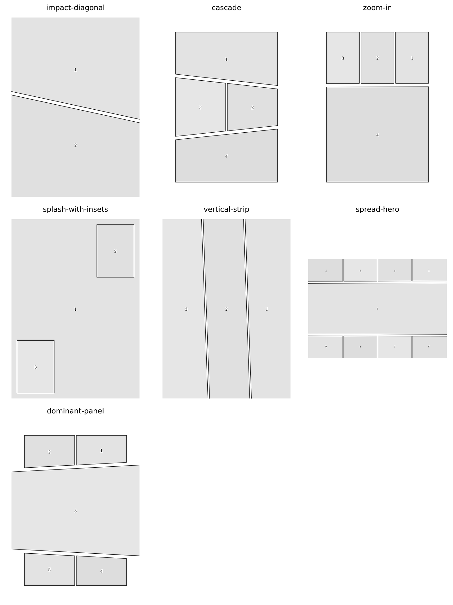
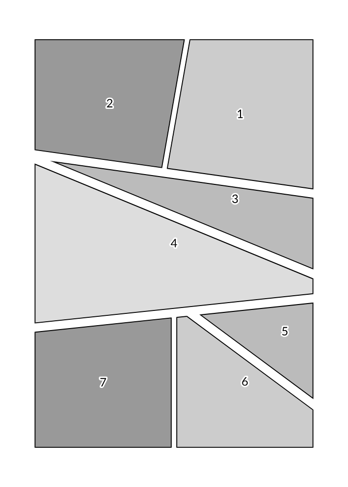

# 4. ページとコマ

## コマ・ページの合成後フィルタ

コマに `invert: true` を 1 行加えると、背景・絵・効果線・描き文字を合成した後に反転する。吹き出し（中の文字を含む）と通常の文字・ナレーションは既定では反転しない。

```yaml
pages:
  - panels:
      - invert: true
        layers:
          - { effect: focus-lines }
          - { sfx: ドン, at: [50%, 60%] }
          - { balloon: 反転しても読める, place: top-right }
      - filters: [grayscale, "threshold(0.5)"]
        exclude: []
        layers:
          - { balloon: この吹き出しも処理する }
```

`filters` は画像と同じフィルタを記述順に適用する。`invert: true` はその末尾に `invert` を追加する指定。`exclude` は処理から外す要素種別で、`balloons`、`text`、`sfx`、`effects`、`images` を指定できる。省略時は `[balloons, text]`、`[]` は全要素を処理する。除外要素は相互の順序を保って処理済みの絵の上に重ねる。コマの枠線は処理しない。コマからはみ出す要素も、所属するコマの指定に従う。

`pages[]` にも同じ指定ができ、コマとページレイヤーを合成した後に処理する（`page` に書けば全ページの既定値）。ページの紙の背景・コマ枠も含め、ノンブルは常に除外する。コマとページ両方に指定すると順に適用する。透過部分は反転しても不透明にならない。

PNG・PDF・PSD はラスターフィルタを使用する。SVG は `invert`、`grayscale`、`brightness`、`contrast`、`threshold`、`levels` に対応し、未対応のフィルタは `SVG_FILTER_UNSUPPORTED` 警告を出して省略する。実例は [panel-invert.yaml](examples/panel-invert.yaml)。

## 4.1 ページの幾何

1 ページは、外側から次の 4 つの領域を持つ。

```text
┌───────────────────────────────────────┐ ← 塗り足し（bleed box）
│ ┌───────────────────────────────────┐ │ ← 仕上がり（trim box）
│ │ ┌───────────────────────────────┐ │ │ ← 安全領域（safe area）
│ │ │   ┌───────────────────────┐   │ │ │
│ │ │   │                       │   │ │ │ ← 基本枠（base frame）
│ │ │   │   ここを基準にコマを割る │   │ │ │
│ │ │   │                       │   │ │ │
│ │ │   └───────────────────────┘   │ │ │
│ │ └───────────────────────────────┘ │ │
│ └───────────────────────────────────┘ │
└───────────────────────────────────────┘
```

| 領域 | 定義 | 既定値 |
|---|---|---|
| 仕上がり（trim） | 判型の寸法の矩形。ページ座標の原点はこの左上 | `page.size` |
| 塗り足し（bleed） | 仕上がりを `page.bleed` だけ全方向に広げた矩形 | 3 mm（px で定義した判型では 0） |
| 安全領域（safeArea） | 文字を収めるべき領域。仕上がりを `inset` だけ内側に縮めた矩形 | 内側 5 mm |
| 基本枠（baseFrame） | コマ割りの基準となる領域 | 仕上がりの幅の 82.4 %、高さの 85.6 % を中央に配置（B5 で 150 × 220 mm）。px で定義した判型では、短辺の 4 % の余白を四辺に取る |

原稿と印刷時の寸法を分けるには `page.printScale: 0.83` または `page.printSize: B5`（`[182mm, 257mm]` も可）を指定する。両方の同時指定はエラー。既定の倍率は 1、範囲は `0 < s <= 1`。`printSize` は `orientation` を反映した印刷幅 ÷ 原稿の仕上がり幅で倍率を求め、縦横とも同じ倍率で縮小する（縦横比が異なる場合、高さは指定サイズと一致しない）。見開きでは 1 ページ分の幅を使う。解決した倍率は API の `layout[].geom.printScale` に入る。

長さには `14Q@print`、`0.3mm@print` のように `@print` を付けられる。印刷後の寸法を表し、原稿上では倍率で割った mm に解決する。文字サイズ、線幅などに共通。トーンは `lpi: "85@print"` または `tone(20%, 85lpi@print)` とし、原稿の線数は `85 * s` になる。接尾辞なしの長さ・線数は従来どおり原稿基準。

### 4.1.1 基本枠の指定

```yaml
page:
  baseFrame:
    size: [150mm, 220mm]     # 寸法で指定（中央に配置）
    offset: [0, -2mm]        # 中央からのずれ
```

```yaml
page:
  baseFrame:
    margins: { top: 18mm, bottom: 19mm, inner: 16mm, outer: 16mm }   # 余白で指定
```

```yaml
page:
  baseFrame: trim            # 仕上がりと同じ（余白なし。SNS 向けなど）
```

- `size` と `margins` は同時に指定できない。
- `margins` の `inner`（のど）と `outer`（小口）は、ページが左右どちらにあるか（[4.3](#43-本の設定)）によって左右に割り当てる。左ページではのどが右、右ページではのどが左である。
- 基本枠は安全領域の内側になければならない。はみ出す場合は警告（`PAGE_BASEFRAME_OUTSIDE_SAFE`）。

## 4.2 判型プリセット

| 名前 | 寸法 | 単位 | 用途 |
|---|---|---|---|
| `A4` | 210 × 297 | mm | |
| `A5` | 148 × 210 | mm | 同人誌など |
| `A6` | 105 × 148 | mm | 文庫判 |
| `B4` | 257 × 364 | mm | |
| `manga-b4` | 220 × 310 | mm | 商業漫画原稿（暫定）。基本枠 180 × 270 mm、塗り足し 5 mm、`printSize: B5` |
| `B5` | 182 × 257 | mm | 同人誌・漫画雑誌（**既定**） |
| `B6` | 128 × 182 | mm | 単行本など |
| `postcard` | 100 × 148 | mm | はがき |
| `shiroku` | 127 × 188 | mm | 四六判 |
| `shinsho` | 103 × 182 | mm | 書籍の新書判 |
| `sns-portrait` | 1080 × 1350 | px | SNS 縦長 |
| `sns-square` | 1080 × 1080 | px | SNS 正方形 |
| `sns-landscape` | 1600 × 900 | px | SNS 横長 |

- 任意の寸法は `size: [182mm, 257mm]`、`size: [1080px, 1350px]` のように指定する。
- `orientation: landscape` を指定すると縦横を入れ替える。
- プラグインで判型プリセットを追加できる（[11.8](11-api.md#118-プラグイン)）。

`manga-b4` の数値は暫定。設定ファイルの `pageSizes`、または `override: true` のプラグインの `pageSizes` で同名プリセットを置換できる。プリセットは寸法に加え `baseFrame`、`bleed`、`printSize`、`dpi` を持てる。ドキュメント／各ページの明示指定が優先される（明示した `printScale` はプリセットの `printSize` を置き換える）。例:

```ts
export default {
  pageSizes: {
    "manga-b4": {
      width: 220, height: 310, unit: "mm",
      baseFrame: { size: ["180mm", "270mm"] },
      bleed: "5mm", printSize: "B5", dpi: 600,
    },
  },
};
```

## 4.3 本の設定

```yaml
book:
  binding: right             # 右綴じ
  readingDirection: rtl      # 右から左へ読む
  firstPageSide: left        # 1 ページ目は左ページ
  pageNumbers:
    start: 1
    position: bottom-outer
```

| キー | 型 | 既定値 | 説明 |
|---|---|---|---|
| `binding` | `right` \| `left` | `right` | 綴じ方向。`meta.lang` が `ja` 以外のときは `left` |
| `readingDirection` | `rtl` \| `ltr` | `binding` が `right` なら `rtl`、`left` なら `ltr` | コマと吹き出しの読み順の方向 |
| `firstPageSide` | `left` \| `right` | `binding` が `right` なら `left`、`left` なら `right` | 1 ページ目が見開きのどちら側か |
| `pageNumbers` | PageNumbers | 下記 | ノンブル（[4.13](#413-ノンブル)） |
| `signature` | 整数 \| `false` | `4` | 印刷用のプロファイルで出力するとき、物理的なページ数がこの数の倍数でなければ情報（`BOOK_PAGE_COUNT`）を出す（中綴じ・無線綴じの台割りの確認） |

### 4.3.1 ページの左右

ページ i（1 始まりの**物理的なページの番号**。白ページを数え、見開きは 2 ページと数える）の左右は次のように決まる。

- `firstPageSide` が `left` の場合: i が奇数なら左ページ、偶数なら右ページ。
- `firstPageSide` が `right` の場合: i が奇数なら右ページ、偶数なら左ページ。

右綴じの本では、偶数ページ（右）と次の奇数ページ（左）が見開きになる。ページの左右は、基本枠の `inner` / `outer` の割り当て、ノンブルの位置、見開きの検証に使う。

## 4.4 ページ種別

| `type` | 説明 | 優先度 |
|---|---|---|
| `page` | 通常のページ（**既定**） | P0 |
| `spread` | 見開き。2 ページ分の幅を持つ 1 枚のページ（[4.15](#415-見開き)） | P1 |
| `blank` | 白ページ。コマを描かない（ノンブル・柱は指定に従う） | P1 |
| `strip` | 縦スクロール漫画。幅は固定、高さはコマの積み重ねで決まる | P2 |

表紙・扉・中表紙は専用の種類を設けず、通常のページ（断ち切りの 1 コマ、`border: none`、題の `text` 要素など）で表す。

`strip` は将来の拡張としてキーだけを予約する。予定する主なプロパティは `width`、`gap`（コマ間の余白）、`panels[].height`、出力時の分割の高さ（`output.strip.sliceHeight`）である。

## 4.5 ページのプロパティ

トップレベルの `page` は全ページの既定値、`pages[]` の各項目は個々のページである。✓ はトップレベルの `page` にも書けるキーを示す。

| キー | 型 | 既定値 | `page` | 説明 |
|---|---|---|---|---|
| `id` | ID | 自動 | | ページの ID |
| `type` | ページ種別 | `page` | | [4.4](#44-ページ種別) |
| `size` | プリセット名 \| Size | `B5` | ✓ | 判型 |
| `orientation` | `portrait` \| `landscape` | `portrait` | ✓ | 向き |
| `units` | `mm` \| `px` \| `pt` \| `in` | 判型による | ✓ | 単位のない数値の単位（[3.5](03-document-format.md#35-単位)） |
| `dpi` | 数値 | 下記 | ✓ | px の換算と、出力解像度の既定値 |
| `bleed` | Length | 3 mm / 0 | ✓ | 塗り足しの幅 |
| `baseFrame` | BaseFrame \| `trim` | 4.1 | ✓ | 基本枠 |
| `safeArea` | `{ inset: Length }` | `{ inset: 5mm }` | ✓ | 安全領域 |
| `gutter` | Length \| `{ col, row }` | `{ col: 2.5mm, row: 5mm }` | ✓ | 間白（[4.6.6](#466-間白gutter)） |
| `background` | Paint \| `{ image, fit?, bleed? }` | `paper` | ✓ | ページの地の塗り、または下敷きの画像 |
| `gutterFill` | Paint \| `none` | `paper` | ✓ | 間白の塗り。`paper` は下敷きの画像があるときだけ塗る |
| `mood` | `flashback` | — | ✓ | 余白・間白を黒くする回想の指定 |
| `flashbackBorder` | `none` \| `white` | `none` | ✓ | 回想のコマ枠。`white` は細い白線 |
| `color` | `mono` \| `color` | `mono` | ✓ | 色の意図（[10.1](10-color-and-output.md#101-カラーモデル)） |
| `layout` | Layout | 1 コマ | | コマ割り（[4.6](#46-コマ割りlayout)） |
| `panels` | Panel[] | - | | コマ（[4.7](#47-コマのプロパティ)） |
| `layers` | Element[] | - | | ページ全体に置く要素（コマをまたぐ吹き出し、ページ全体の効果など） |
| `defaults` | Defaults | - | | このページの既定値（[3.17](03-document-format.md#317-defaults)） |
| `hand` | Hand | - | | このページの手描き設定 |
| `seed` | 整数 | - | | このページのシードの上書き |
| `number` | 真偽値 \| `{ hidden: 真偽値 }` | `true` | | このページにノンブルを付けるか |
| `hashira` | 文字列 \| オブジェクト | - | | 小口の余白に縦書きの柱を置く（[4.14](#414-柱ページ外の注記)） |
| `title` | 文字列 | - | | ページの題（扉など）。セリフ一覧と目次用のメタデータ |
| `foldMargin` | Length | 10 mm | ✓ | 見開き（`type: spread`）で、中央付近の文字を警告する範囲（[4.15](#415-見開き)） |

`dpi` の既定値は、`color` が `mono` なら 600、`color` なら 350、判型を px で定義した場合は 96 とする。

### 4.5.1 ぶち抜きゴマ（ページ全面の絵）

`background: { image: city-night, fit: cover, bleed: all }` で、ページ全体の下に 1 枚の絵を敷く。`image` は素材 ID または画像パス。`fit` は画像要素と同じ指定で、既定は `cover`。`bleed: all` は塗り足しまで広げ、省略時は仕上がりの範囲に収める。

`gutterFill: none` なら間白からも絵が見える。既定の `paper` はレイアウト領域内でコマに覆われない部分を白く塗る（画像のないページには影響しない）。コマを `background: none, border: none` にすると、枠線も地の塗りもなく、下敷きが見える。別のコマに `knockout: 1.5mm` を付けると、コマの輪郭の外側を白く抜く。読み順や自動配置の指定は通常のコマ割りと同じ。

[YAML 作例](examples/full-page-art.yaml) · [出力画像](images/full-page-art.png)

### 回想（`mood`）

ページに `mood: flashback` を指定すると、塗り足しまでの余白と間白が黒くなり、すべてのコマが回想になる。通常のページで一部のコマだけを回想にする場合は、そのコマに指定する。回想のコマの周囲は間白の幅だけ黒く広がり、基本枠の外周に接する辺は塗り足しまで黒くなる。通常のコマ同士の間白は変わらない。

```yaml
pages:
  - mood: flashback
    flashbackBorder: white
    panels:
      - dialogue: [{ as: narration, text: あの夏のことだった。 }]
```

回想のコマ枠は既定で消える。`flashbackBorder: white` なら仕上がり寸法で 0.3mm の白線になり、コマ側の値がページ側より優先される。コマの `border` を明示すればその指定を使う。コマの地は `paper` のまま。`as: narration` の吹き出しだけが黒地・白文字・白枠になり、通常のセリフは白地のままになる。吹き出しの `fill`・`color`・`stroke`、ページの `background`・`gutterFill` などを明示した場合は、その指定を優先する。下敷き画像のある回想ページでも、間白の既定値は黒になる。

`gutterFill: black` や `gutterFill: tone(30%)` は、画像のない通常ページでも使える。`none` は間白を塗らず、`paper` は従来どおり画像のあるページだけを白く覆う。

ナレーションの `fill` または文字の `color` を、吹き出し自身・`style`・文書やページやコマの `defaults` で指定した場合は、回想による配色の変更を行わない。塗り・文字色・枠線をまとめて通常の指定どおりに保つ。

[YAML 作例](examples/flashback.yaml) · [出力画像](images/flashback.png)

## 4.6 コマ割り（layout）

コマ割りは、レイアウト領域（既定は基本枠）をコマに分割する。4 つの方法がある。

| 方法 | 用途 | 優先度 |
|---|---|---|
| `rows`（段組） | 段ごとにコマを並べる。最もよく使う | P0 |
| `split`（分割木） | 分割を入れ子にする。複雑なコマ割り | P0 |
| `free`（自由配置） | コマごとに矩形や多角形で指定する | P0 |
| `template`（テンプレート） | 4 コマなどの定型 | P1 |

`layout` を省略した場合は、次のように扱う。

- `overlay` でないすべてのコマが `box` または `polygon` を持つ場合: 自由配置（`free`）。
- どのコマも持たない場合: レイアウト領域全体を 1 コマとする（コマが 2 つ以上ならエラー `LAYOUT_TOO_MANY_PANELS`）。
- 一部のコマだけが持つ場合: エラー（`LAYOUT_FREE_MIXED`）。

レイアウト領域は `layout.area`（`baseFrame`（既定）\| `trim` \| `bleed` \| Rect）で変更できる。

### 4.6.1 段組（rows）

```yaml
layout:
  rows:
    - [1]                                   # 1 段目: 1 コマ
    - { cols: [2, 1], height: 1.4 }         # 2 段目: 読み順に 2:1 の幅（右綴じなら右が広い）
    - { cols: [1, 1, 1], height: 60mm, slant: 4mm }
```

| キー | 型 | 既定値 | 説明 |
|---|---|---|---|
| `cols` | 数値[] | `[1]` | 段のコマの幅の比。**読み順に並べる**（右から左に読む場合は、最初の値が右端のコマ） |
| `height` | 数値 \| Length | `1` | 段の高さ。数値は比、長さは絶対値。絶対値の段と間白を引いた残りを比で分ける |
| `slant` | Length / Angle | `0` | この段の下の境界の傾き。境界の右端の y から左端の y を引いた値。正なら右下がり。`8deg` のような角度も指定できる |
| `colSlant` | (Length / Angle)[] | すべて `0` | 段の中のコマ間の境界の傾き（読み順の境界ごと）。境界の下端の x から上端の x を引いた値 |
| `gutter` | `{ col: Length }` | ページの値 | この段のコマ間の間白 |

- 段のリストの要素に数値のリスト（`[2, 1]`）を書くと、`{ cols: [2, 1], height: 1 }` とみなす。
- 列（左右方向）の比は段ごとに独立する。

### 4.6.2 分割木（split）

```yaml
layout:
  split: rows               # rows: 上から下へ積む / cols: 読み順に左右へ並べる
  sizes: [3, 2]
  slant: [5mm]              # 境界ごとの傾き
  children:
    - split: cols
      sizes: [1, 2]
      children: [panel, panel]
    - panel
```

| キー | 型 | 既定値 | 説明 |
|---|---|---|---|
| `split` | `rows` \| `cols` \| `{ line: [[x1, y1], [x2, y2]] }` | 必須 | 分割の方向、または 2 点を通る直線。`cols` の子は読み順に並べる |
| `sizes` | (数値 \| Length)[] | すべて `1` | 子の大きさ。比または絶対値。要素数は `children` と同じ |
| `slant` | (Length / Angle)[] | すべて `0` | 子の間の境界の傾き。意味は `rows` の `slant`（`split: rows`）、`colSlant`（`split: cols`）と同じ |
| `gutter` | Length | ページの値 | この分割の間白（`rows` なら上下、`cols` なら左右） |
| `children` | (Split \| `panel` \| `{ panel: ID }`)[] | 必須 | 子。`panel` は葉（コマ）。`{ panel: ID }` は特定の ID のコマを割り当てる |

`split: { line: [[x1, y1], [x2, y2]] }` は、2 点を通る直線を親の多角形全体まで延ばして分割する。座標は親の外接矩形の左上からの Length または `%`。子は必ず 2 つとし、入れ子や `{ panel: ID }` も使える。

```yaml
layout:
  split: cols
  children:
    - split: { line: [[0%, 0%], [100%, 70%]] }
      gutter: 4mm
      children: [panel, panel]
    - panel
```

横に近い直線（`|dx| >= |dy|`）は上側の子が先、縦に近い直線は読み始め側（RTL なら右、LTR なら左）の子が先になる。既定の間白は横に近ければ段間、縦に近ければコマ間の値。間白は直線に垂直に測る。親を 2 つの空でない領域に分けられない直線はエラーになる。

### 4.6.3 自由配置（free）

コマの位置を直接指定する。`layout: free` と書くか、`layout` を省略してすべてのコマに `box` または `polygon` を書く。

```yaml
layout: free
panels:
  - box: [0, 0, 100%, 46%]
  - polygon: [[0, 49%], [100%, 54%], [100%, 100%], [0, 100%]]
```

- 座標は基本枠座標（[3.6](03-document-format.md#36-座標系)）で表す。コマに `coords: page` を書くとページ座標になる。
- 自由配置では間白を自動では空けない。コマの重なりは警告（`LAYOUT_PANELS_OVERLAP`）とする。意図的に重ねる場合は `overlay: true`（[4.10](#410-特殊なコマ)）を使う。

### 4.6.4 テンプレート（template）

（P1）

```yaml
layout:
  template: yonkoma
  params: { title: true }
```

| テンプレート | パラメータ | 内容 |
|---|---|---|
| `single` | - | 1 コマ |
| `grid` | `cols`、`rows` | 等分の格子 |
| `tiers` | `counts`（例: `[1, 2, 2]`） | 段ごとのコマ数を指定した等幅の段組 |
| `yonkoma` | `title`（真偽値）、`titleHeight`、`columns`（`1` \| `2`） | 4 コマ漫画。`title: true` で上部に題の欄を作る。`columns: 2` で 2 本を読み順に並べる |
| `hero-top` | `ratio`（大ゴマの高さの比、既定 0.5）、`below`（下段の cols） | 上に大ゴマ、下に小ゴマ |
| `hero-bottom` | `ratio`、`above` | 下に大ゴマ |
| `impact-diagonal` | `angle`（12 度）、`ratio`（0.5）、`direction`（`rows` / `cols`） | 斜めの太い間白で 2 分割 |
| `cascade` | `counts`（`[1,2,1]`）、`angle`（6 度）、`heights` | 傾きが交互に反転する段組 |
| `zoom-in` | `count`（3）、`ratio`（0.65）、`angle`（0 度） | 上に等幅の小ゴマ、下に大ゴマ |
| `splash-with-insets` | `count`（1–3、既定 2）、`corners`（`[top-right,bottom-left]`）、`size`（0.3） | 全面の大ゴマに枠付き小ゴマを重ねる |
| `vertical-strip` | `count`（3）、`ratios`（幅の比）、`angle`（2 度） | 右から左に読む縦長のコマ |
| `spread-hero` | `ratio`（0.55）、`counts`（`[2,2]`）、`angle`（0 度） | 中央に見開き大ゴマ。上下段の指定数は片側ごとで、ノドをまたがない。単ページでも使用可 |

動的テンプレートは `seed` とページ ID から微小な角度揺らぎ（±0.4 度）を決定する。同じ seed・ID なら再現できる。角度は度数法で、`impact-diagonal` の既定角は 8–20 度に制限する（明示指定は制限しない）。`splash-with-insets` は角度ではなく小ゴマの余白を微調整する。
`impact-diagonal`、`vertical-strip`、`spread-hero`、`splash-with-insets` は既定で仕上がりまで広げ、外周に接する辺を自動で塗り足す。`params: { bleed: false }` で無効化でき、コマ自身の `bleed` 指定を優先する。
小ゴマは通常の枠線で大ゴマの上に描画する。読み順は大ゴマが最初、その後は右上・左上・右下・左下の順（LTR では左右反転）。その他のテンプレートも書籍の読み方向に従う。



ギャラリーは `npx tsx scripts/gallery-templates.ts` で再生成できる。

テンプレートは内部で `rows` または `split` に展開する。`mangacli inspect --layout` で展開結果を確認できる。プラグインでテンプレートを追加できる。

`yonkoma` の題の欄は `border: none` の特別なコマ（ID 末尾 `-title`）になり、`panels` の割り当て対象には含めない。題の文字はページの `title` から、`text` 要素として自動で配置する（フォントは `title` ロール）。

### 4.6.5 斜めの間白（slant）

- 境界は直線とし、`slant` / `colSlant` で傾ける。
- 長さの代わりに `8deg`、`-8deg` のような角度を指定できる（`rad`、`turn` も可）。数値だけなら従来どおり長さとして扱う。段境界は `tan(角度) × 領域の幅`、列境界は `tan(角度) × 領域の高さ` に換算する。段内の列境界にはその段の外接矩形、分割木には親の外接矩形を使う。正の角度は段なら右下がり、列なら下端が右に寄る。
- 間白は境界線に垂直な方向で測った幅を保つ。すなわち、境界線をその法線方向に ±（間白 / 2）だけ平行移動した 2 本の直線でコマを区切る。
- 傾けた結果、コマの最小幅が 5 mm 未満になる場合、または多角形が自己交差する場合はエラー（`LAYOUT_DEGENERATE_PANEL`）とする。

[斜め分割の例](examples/diagonal-splits.yaml) は角度指定、角から辺への分割、T 字の接続をまとめて示す。



矩形だけのページが 3 ページ以上続き、その中に描き文字や線の演出があると `LAYOUT_MONOTONE` を警告する。空白ページ・コマのないページは連続を区切る。斜めの辺または矩形以外のコマがあれば連続を区切り、警告は連続区間の最初のページに 1 回だけ出す。

### 4.6.6 間白（gutter）

| キー | 意味 | 既定値（B5 基準） |
|---|---|---|
| `col` | 左右に並んだコマの間（縦の帯） | 2.5 mm |
| `row` | 上下に並んだコマの間（横の帯） | 5 mm |

日本の漫画の慣習に合わせ、上下の間白を左右の間白より広くするのを既定とする。`gutter: 3mm` のように 1 つの値を書くと両方に適用する。

### 4.6.7 コマの割り当て

- レイアウトの葉（コマの枠）を読み順（[4.11](#411-読み順)）に並べ、`panels` のリストを先頭から順に割り当てる。
- `split` の葉に `{ panel: ID }` を書いた場合は、その ID のコマを割り当て、順番による割り当ての対象から外す。
- `panels` が葉の数より少ない場合、残った葉は空のコマ（枠線だけ）になり、警告（`LAYOUT_EMPTY_SLOT`）を出す。
- `panels` が葉の数より多い場合はエラー（`LAYOUT_TOO_MANY_PANELS`）。ただし `overlay: true` のコマは数えない。

### 4.6.8 コマの多角形の計算

1. レイアウト領域の矩形から始める。
2. 分割を再帰的に適用し、境界の直線で領域を凸多角形に分ける。
3. 各境界線を法線方向に ±（間白 / 2）平行移動し、コマの多角形を縮める。
4. 断ち切り（[4.8](#48-断ち切り)）を適用する。
5. コマの形状（`shape`、[4.10](#410-特殊なコマ)）を、多角形に内接するように適用する。

## 4.7 コマのプロパティ

| キー | 型 | 既定値 | 説明 |
|---|---|---|---|
| `id` | ID | 自動 | コマの ID |
| `box` | Rect | - | 自由配置の矩形 |
| `polygon` | Point[] | - | 自由配置の多角形（3 頂点以上、凸でなくてもよい） |
| `coords` | `baseFrame` \| `page` | `baseFrame` | `box` / `polygon` の座標系 |
| `shape` | `rect` \| `ellipse` \| `cloud` \| `{ kind: rounded, radius }` | `rect` | コマの形（[4.10](#410-特殊なコマ)） |
| `border` | Border \| `none` | [4.9](#49-枠線border) | 枠線 |
| `bleed` | 辺[] \| `all` \| `false` | `false` | 断ち切りにする辺（`top`、`right`、`bottom`、`left`） |
| `dominant` | `true` \| `{ overlap?: Length, bleed?: 辺[] \| all \| false }` | - | 周囲のコマより手前に描く大ゴマ（[4.8.1](#481-大ゴマdominant)） |
| `background` | Paint | `paper` | コマの地の塗り |
| `mood` | `flashback` | ページに従う | 回想。周囲の余白・間白を黒くする |
| `flashbackBorder` | `none` \| `white` | ページに従う（`none`） | 回想の枠線。明示した `border` が優先 |
| `layers` | Element[] | - | コマに置く要素。リストの順に下から重ねる |
| `dialogue` | DialogueLine[] | - | セリフの省略記法（[6.11](06-balloons.md#611-セリフの省略記法dialogue)） |
| `defaults` | Defaults | - | このコマの既定値 |
| `hand` | Hand | - | このコマの手描き設定 |
| `seed` | 整数 | - | このコマのシードの上書き |
| `z` | 数値 | `0` | コマの重なり順 |
| `order` | 整数 | 自動 | 読み順の上書き（1 始まり） |
| `overlay` | 真偽値 | `false` | レイアウトの葉に割り当てず、`box` / `polygon` で他のコマの上に重ねる |
| `knockout` | Length | `0` | コマの輪郭から外側へこの幅だけ抜く。ページの下敷きが画像なら白、塗りならページの地の色を使う |
| `visible` | 真偽値 | `true` | 描画するか |
| `note` | 文字列 | - | メモ。描画しない。デバッグ表示と `inspect` に出す |

## 4.8 断ち切り

```yaml
panels:
  - bleed: [top, right]      # 上と右を塗り足しの端まで広げる
```

1. 断ち切りにできるのは、レイアウト領域の外周に接している辺（誤差 0.01 mm 以内）だけである。接していない辺を指定した場合は警告（`LAYOUT_BLEED_NOT_ON_EDGE`）を出し、無視する。
2. 断ち切りにした辺は、塗り足しの端まで外側へ移動する。隣接する 2 辺は、その直線の延長上で伸ばす。
3. 断ち切りにした辺に隣接する間白も、塗り足しの端まで延びる。
4. 断ち切りにした辺の枠線は描かない。
5. 断ち切りのコマの表示領域（% の基準）は、コマの多角形と仕上がりの共通部分の外接矩形とする（[3.6](03-document-format.md#36-座標系)）。一方、画像の `fit` の基準は塗り足しを含むコマ全体の外接矩形とする（[5.5](05-elements-and-images.md#55-画像image)）。これにより、背景画像は塗り足しまで覆い、配置の % は見えている範囲を基準にできる。
6. 1 コマのページで `bleed: all` とすると、ページ全面の断ち切り（1 ページ大ゴマ）になる。

### 4.8.1 大ゴマ（dominant）

クライマックスなどで、ひとつのコマを間白の向こうへ張り出させる。

```yaml
panels:
  - dominant: { overlap: 8mm, bleed: [top, right] }
  - {}
```

- `dominant: true` は外周に接する辺だけを自動で断ち切りにする。外周にない辺の警告は出さない。
- `dominant.bleed` で断ち切りの辺を選べる。コマ自身の `bleed` があればそちらを優先する。`false` は断ち切りなし。
- `overlap`（既定値 `0`）は内部の各辺を法線方向へ広げる量。斜めの間白や `split.line` にも使える。外周はレイアウト領域（断ち切りの辺では塗り足し）を越えない。
- 隣のコマを切り詰め、もとの間白の幅を保つ。分断されたコマは最大の部分だけを残し、`LAYOUT_DOMINANT_SPLIT` を警告する。小さくなりすぎた場合は `LAYOUT_DEGENERATE_PANEL` エラー。
- 大ゴマは隣のコマより手前に描き、内部の枠線は残す。読み順は張り出す前の配置で決める（`order` の指定も有効）。吹き出しの `contain: panel` は切り詰めた輪郭を使い、文字の安全領域や回想の黒い間白は通常どおり適用する。
- 1 ページに 1 コマを想定する。複数指定すると `LAYOUT_DOMINANT_MULTIPLE` を警告する。

作例: [dominant-panel.yaml](examples/dominant-panel.yaml) / [描画結果](images/dominant-panel.png)。

## 4.9 枠線（border）

```yaml
defaults:
  panel:
    border:
      width: 0.5mm
      color: black
      pen: kabura-pen
      ruler: true
      join: clean
```

| キー | 型 | 既定値 | 説明 |
|---|---|---|---|
| `style` | `solid` \| `none` \| `double` \| `dashed` \| `wavy` \| `blur` | `solid` | 線の種類。`double`、`dashed`、`wavy`、`blur` は P1 |
| `width` | Length | 0.5 mm | 線幅 |
| `color` | Color | `black` | 線の色 |
| `pen` | Pen | `kabura-pen` | ペン（[9.7](09-hand-drawn.md#97-ペンプリセット)） |
| `ruler` | 真偽値 | `true` | 定規で引いた線にする（[9.6](09-hand-drawn.md#96-定規モード)） |
| `join` | `clean` \| `overshoot` \| `gap` | `clean` | 角の処理。`clean` は角で正確に合わせる。`overshoot` は角で線がわずかに突き抜ける。`gap` は角でわずかに隙間ができる |
| `overshoot` | Range | `hand.overshoot` の値 | `join: overshoot` のときの突き抜けの長さ |
| `double` | `{ gap, inner }` | `{ gap: 0.6mm, inner: 0.25mm }` | `style: double` の線の間隔と内側の線幅 |
| `dash` | `[線, 隙間]` | `[3mm, 1.5mm]` | `style: dashed` の線と隙間の長さ |
| `wave` | `{ amplitude, wavelength }` | `{ amplitude: 0.8mm, wavelength: 8mm }` | `style: wavy` の波 |
| `blur` | `{ width, color }` | `{ width: 6mm, color: paper }` | `style: blur` のぼかし（コマの縁を地の色へ溶かす）。モノクロでは網点化する |
| `sides` | Map\<辺, Border \| `none`\> | - | 辺ごとの上書き（P1）。多角形のコマでは辺の向きで判定する |
| `hand` | Hand | - | 枠線だけの手描き設定 |

## 4.10 特殊なコマ

| 表現 | 指定方法 | 優先度 |
|---|---|---|
| 重ねゴマ（他のコマの上に置く小さなコマ） | `overlay: true` + `box` / `polygon` + `z: 1` + `knockout: 1.5mm` | P1 |
| 枠なしゴマ | `border: none`、必要なら `background: none` | P0 |
| 丸ゴマ | `shape: ellipse`（枠に内接する楕円） | P1 |
| 雲形ゴマ（回想・想像） | `shape: cloud`（パラメータは吹き出しの `cloud` と同じ、[6.3](06-balloons.md#63-形状shape)） | P1 |
| 角丸ゴマ | `shape: { kind: rounded, radius: 3mm }` | P1 |
| ぼかし枠（回想） | `border: { style: blur }` | P1 |
| 台形・斜めのコマ | `slant` / `colSlant` または `polygon` | P0 |

コマの形状に揺らぎを与える場合（雲形など）は、手描き化の設定に従う。矩形のコマは定規で引いたものとして扱う（[9.6](09-hand-drawn.md#96-定規モード)）。

## 4.11 読み順

コマの読み順は次のように決める。

1. `rows`: 段を上から下へ、段の中は読み方向（`rtl` なら右から左）に並べる。
2. `split`: 深さ優先で並べる。`split: rows` の子は上から下へ、`split: cols` の子は `children` の順（読み順に並べて書く規約）。
3. `free` のコマ: 再帰的な切断（XY カット）で並べる。
   1. 対象のコマの集合について、どのコマとも交わらずに集合の外接矩形を横切る水平な隙間（幅 1 mm 以上）を探す。見つかれば、その隙間で上下に分け、上の集合、下の集合の順に再帰的に並べる。隙間が複数あれば、すべての隙間で同時に分ける。
   2. 水平な隙間がなければ、垂直な隙間を同様に探し、左右に分けて、`rtl` なら右の集合から、`ltr` なら左の集合から再帰的に並べる。
   3. どちらの隙間もない場合（コマが重なっている、L 字に食い込んでいるなど）は、外接矩形の上端の y の小さい順に並べ、上端の差が 2 mm 以内のものは `rtl` なら右端の x の大きい順（`ltr` なら左端の x の小さい順）、それも等しければ `panels` のリストの順とする。
   4. この規則により、右に縦長のコマ、左に上下 2 つのコマを並べた配置は、右のコマ → 左上 → 左下の順になる。
4. `overlay` のコマ: 上記で並べた後、重ねゴマの中心を含むコマ（含むコマがなければ、最も重なりの面積が大きいコマ）の直後に入れる。同じコマの直後に複数入る場合は、3. の規則で並べる。
5. `order` を持つコマは、その位置（1 始まり）に置く。他のコマは、残りの位置に上記の順で詰める。`order` の重複はエラー（`LAYOUT_ORDER_DUPLICATE`）。

読み順は、コマの割り当て（[4.6.7](#467-コマの割り当て)）、吹き出しの自動配置、セリフ一覧、デバッグ表示に使う。自動 ID には使わない（[3.7.1](03-document-format.md#371-id)）。

## 4.12 描画順

1 ページは次の順に描く。

1. ページの地（`page.background`）を塗り足しの全体に塗る。下敷きの画像を指定した場合は白地の上に画像を置き、`gutterFill` に応じて間白を塗る。
2. コマを（`z`、読み順）の昇順に描く。各コマについて:
   1. `knockout` があれば、コマの周囲を白（画像の下敷きがある場合）またはページの地の色で抜く。
   2. コマの形でクリップする。
   3. コマの地（`background`）を塗る。
   4. `clip: panel` の要素（[5.4](05-elements-and-images.md#54-クリップとはみ出し)）を（`z`、リストの順）の昇順に描く。
   5. クリップを解除し、枠線を描く。
3. 「枠の外の層」として、すべてのコマの `clip: panel` 以外の要素（吹き出しの既定、はみ出す画像など）と、ページの `layers` の要素（`stack: under` を除く）を、次の順に並べて描く。
   1. 要素の `z` の昇順
   2. `z` が等しい場合は、要素の種類の層: 吹き出し以外の要素 → 吹き出し → 地の文字・描き文字
   3. さらに等しい場合は、コマの要素（コマの描画順）→ ページの `layers` の要素
   4. さらに等しい場合は、リストの順。ただし**吹き出し同士はリストで先のものを上に描く**（先に読む吹き出しが手前に来る、漫画の慣習。[6.9.2](06-balloons.md#692-重なり)）
4. ページの付加物（ノンブル）を描く。
5. デバッグオーバーレイ（指定時）を描く。
6. 出力時に、トンボなど仕上がり外の付加物を描く（[10.6](10-color-and-output.md#106-出力範囲とトンボ)）。

- ページの `layers` の要素に `stack: under` を指定すると、手順 1 の直後（コマより下）に描く。ページ全体の背景の絵や、間白に見せる模様に使う。
- `clip: { to: [コマID, ...] }` は複数コマの和集合でクリップする。既定の `stack: over` は手順 3、`stack: art` は各対象コマの手順 2.4 に挿入する。`open` 方向のコマ外部分は手順 3 で描く（[5.4.1](05-elements-and-images.md#541-はみ出しの表現)）。
- 吹き出しは既定の `contain: panel` によりコマ内に収まり、辺寄せの本体と尾はコマの形で切り、枠線を上に描く。`contain: none` または `bridge: true` では従来の `clip: auto` が働き、コマ間の枠線をまたげる（[5.4](05-elements-and-images.md#54-クリップとはみ出し)）。
- ページ全体にかける効果（複数のコマにまたがる流線など）を吹き出しより下に描くには、ページの `layers` に置けばよい（手順 3 の 2. により、吹き出しの下になる）。
- `clip: { to: panel, open: [...] }` の要素は手順 3 で描くが、開放しない辺では、コマの多角形を枠線の幅の半分だけ内側に縮めた形でクリップする。これにより、枠線の内側半分を覆わない（[5.4](05-elements-and-images.md#54-クリップとはみ出し)）。

## 4.13 ノンブル

（P1）

```yaml
book:
  pageNumbers:
    enabled: true
    show: print
    start: 1
    position: bottom-outer
    margin: [8mm, 12mm]
    fontSize: 8pt
    format: "{n}"
    hidden: false
```

| キー | 型 | 既定値 | 説明 |
|---|---|---|---|
| `enabled` | 真偽値 | `true` | ノンブルを使うか |
| `show` | `print` \| `always` \| `never` | `print` | 描画する条件。`print` は印刷用プロファイル（[10.7](10-color-and-output.md#107-出力プロファイル)）でのみ描画する |
| `start` | 整数 | `1` | 1 ページ目の番号 |
| `position` | `bottom-outer` \| `bottom-center` \| `bottom-inner` \| `top-outer` \| `top-center` \| `outer-middle` | `bottom-outer` | 位置。`outer` / `inner` はページの左右（[4.3.1](#431-ページの左右)）で左右に読み替える。`outer-middle` は小口側の上下中央 |
| `margin` | `[天地からの距離, 小口・のどからの距離]` | `[8mm, 12mm]` | 仕上がりの端からの距離。`outer-middle` で省略した場合、収まる幅があれば小口の仕上がり線と基本枠の間の中央に置く |
| `font` | フォント名 | `ui` ロール | フォント |
| `fontSize` | Length | 8 pt | 文字サイズ |
| `color` | Color | `black` | 色 |
| `format` | 文字列 | `"{n}"` | 書式。文字列中のすべての `{n}` をページ番号に置き換える |
| `writing` | `horizontal` \| `vertical` | `horizontal` | 向き |
| `hidden` | 真偽値 | `false` | 隠しノンブル。`true` にすると、のど側の仕上がりの端から 3 mm 以内に 5 pt で置く |
| `autoHide` | 真偽値 | `true` | ノンブルの位置が断ち切りのコマ（裁ち落としまで伸ばしたコマ）に重なるページでは、自動で隠しノンブルにする |
| `countBlank` | 真偽値 | `true` | 白ページを番号に数えるか |
| `skip` | ID[] | - | ノンブルを描かないページ（扉など）。番号は数える |

ページごとに `number: false`（描かない）、`number: { hidden: true }`（そのページだけ隠しノンブル）で上書きできる。

## 4.14 柱・ページ外の注記

雑誌の柱（小口の余白に載せる短い文章）は、個々のページの `hashira` に指定する。

```yaml
pages:
  - id: p3
    hashira: "次のページへつづく"
    panels: [{}]
  - id: p4
    hashira:
      text: { ja: "本編のつづき", en: "Story continues" }
      font: narration
      fontSize: 12Q@print
      align: top
    panels: [{}]
```

| キー | 型 | 既定値 | 説明 |
|---|---|---|---|
| `text` | 文字列 \| 言語別の文字列 | 必須 | 縦書きのプレーンテキスト。自動改行はせず、手動の改行で右から左へ列を増やす |
| `font` | フォント名 | `narration` | フォントまたはロール |
| `fontSize` | Length | `8pt` | 文字サイズ。`@print` で印刷時の寸法を指定できる |
| `color` | Color | `black` | 文字色 |
| `align` | `top` \| `center` \| `bottom` | `center` | 安全領域内での上下の位置 |

小口側の安全線と基本枠の間に置き、左ページでは左、右ページでは右に切り替わる。見開きでは読み順の最初のページの小口に一つ置く。印刷・Web ともに描画し、色分解ではノンブルと同じ `furniture` に入る。

ノンブルと重なる場合は、柱を最も近い空き位置に上下にずらす。収まる位置がない場合は `HASHIRA_NO_SPACE` を出し、柱を描かない。文章を短くするか、文字を小さくするか、小口の余白を広げる。断ち切りなどでコマに重なる場合は `HASHIRA_PANEL_OVERLAP` を出すが、柱は描画する。

ページ外の作業用メモの領域は将来の拡張とする。

## 4.15 見開き

（P1）

```yaml
pages:
  - id: climax
    type: spread
    layout:
      rows:
        - { cols: [1], height: 2 }
        - [1, 1, 1]
    panels:
      - bleed: all
        ...
```

1. 見開きページの仕上がりは、判型の幅の 2 倍、高さは同じとする。塗り足しは外周にだけ付ける。
2. レイアウト領域の既定は、右ページの基本枠と左ページの基本枠、およびその間ののどの部分を含む矩形とする。コマは中央（のど）をまたげる。
3. 見開きは、物理的なページの番号（[4.3.1](#431-ページの左右)）とノンブルを 2 つ使う。`pages` のリストの順番（自動 ID の `p<n>`、ファイル名の `{index}`、API の `PageRef`、CLI の `--pages`）では 1 つと数える。
4. 最初のページ（読み順で先のページ。右綴じなら右側）が右綴じでは右ページ、左綴じでは左ページにならない場合は、警告（`LAYOUT_SPREAD_PARITY`）を出す。右綴じ・`firstPageSide: left` の本では、見開きは偶数ページから始まらなければならない。
5. 文字（吹き出しの本文、地の文字、描き文字）が中央から見開きページの `foldMargin`（既定 10 mm、比例させない）以内に入る場合は警告（`TEXT_NEAR_FOLD`）を出す。
6. 組み込みの既定値の比例の基準は、1 ページ分の短辺とする（[3.5.1](03-document-format.md#351-既定値の寸法の扱い)）。
7. 出力は `output.spread` で選ぶ（[10.9](10-color-and-output.md#109-見開きの出力)）。`joined` は 1 枚の画像、`split` は左右 2 枚の画像（それぞれ塗り足し付き）。ノンブルは左右それぞれに付ける。

## 4.16 検証

ページとコマについて、主に次の診断を出す。一覧は [13.5](13-validation.md#135-診断コード一覧) を参照。

| コード | 重大度 | 条件 |
|---|---|---|
| `PAGE_BASEFRAME_OUTSIDE_SAFE` | 警告 | 基本枠が安全領域からはみ出す |
| `LAYOUT_TOO_MANY_PANELS` | エラー | `panels` がレイアウトの葉より多い |
| `LAYOUT_FREE_MIXED` | エラー | `layout` を省略し、一部のコマだけが `box` / `polygon` を持つ |
| `BOOK_PAGE_COUNT` | 情報 | 物理的なページ数が `book.signature` の倍数でない（印刷用のプロファイルのみ） |
| `LAYOUT_EMPTY_SLOT` | 警告 | 割り当てのない葉がある |
| `LAYOUT_DEGENERATE_PANEL` | エラー | コマが細すぎる、自己交差する |
| `LAYOUT_PANELS_OVERLAP` | 警告 | 自由配置のコマが重なる（`overlay` を除く） |
| `LAYOUT_BLEED_NOT_ON_EDGE` | 警告 | 外周に接していない辺を断ち切りに指定した |
| `LAYOUT_DOMINANT_MULTIPLE` | 警告 | 1 ページに複数の大ゴマを指定した |
| `LAYOUT_DOMINANT_SPLIT` | 警告 | 大ゴマで隣のコマが分断され、最大の部分だけを残した |
| `LAYOUT_DOMINANT_HOLE` | 警告 | 大ゴマの拡張で穴ができるため、重なりを適用しなかった |
| `LAYOUT_ORDER_DUPLICATE` | エラー | `order` が重複する |
| `LAYOUT_SPREAD_PARITY` | 警告 | 見開きの位置が左右の規則に合わない |
| `TEXT_NEAR_FOLD` | 警告 | 見開きの中央付近に文字がある |
