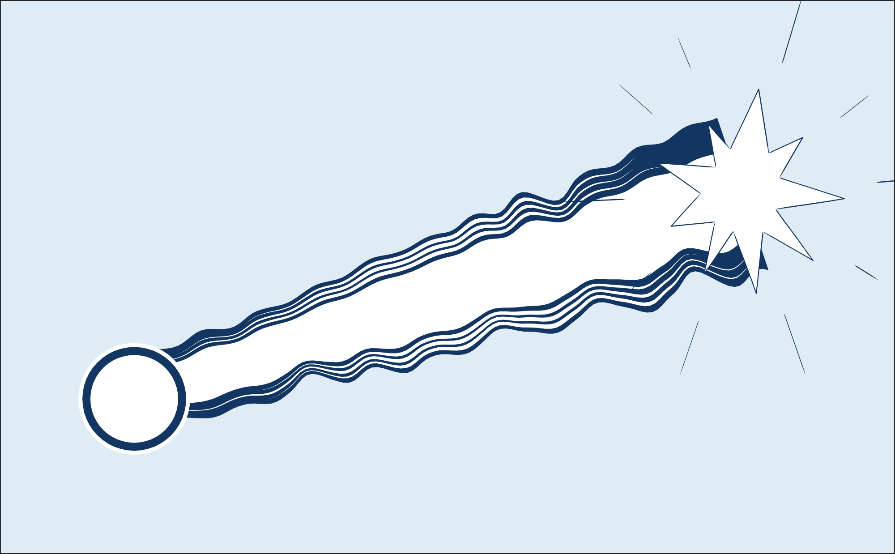
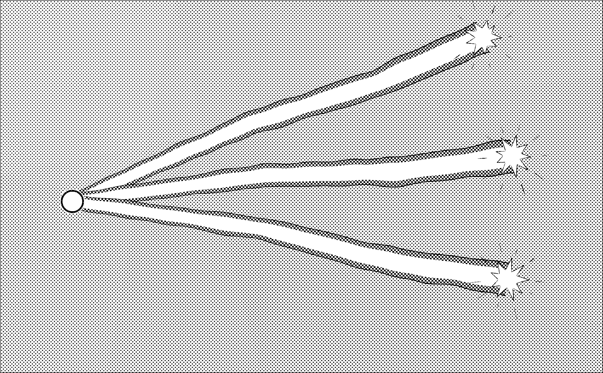

# 8. 効果・トーン・漫符

## 8.1 効果の共通事項

効果は `type: effect` の要素で、`kind` で種類を選ぶ。

```yaml
- effect: focus-lines          # 省略記法
  center: taro1.face
  inner: [30%, 24%]

- type: effect
  kind: speed-lines
  angle: 10deg
  clear: { element: taro1, mode: bbox }
```

### 8.1.1 共通プロパティ

| キー | 型 | 既定値 | 説明 |
|---|---|---|---|
| `kind` | 効果の種類 | 必須 | 下表 |
| `region` | Region | コマ内は `panel`、ページは `bleed` | 効果を描く範囲。線はこの範囲でクリップする |
| `color` | Color | `black` | 線の色。暗い背景の上では `white` も使う |
| `opacity` | 0〜1 | `1` | 不透明度 |
| `pen` | Pen | 種類による（多くは `maru-pen`、[9.14](09-hand-drawn.md#914-既定の適用表)） | 線のペン（[9.7](09-hand-drawn.md#97-ペンプリセット)） |
| `ruler` | 真偽値 | 種類による | 定規で引いた線にする（直線の効果線は `true`） |
| `density` | 数値 | `1` | 線の本数の倍率 |
| `background` | Paint | `none` | 線を描く前に `region` を塗る（例: `paper` で下の絵を隠す） |
| `clear` | Region | - | 線を描かない範囲（人物の顔など）。`feather` で境界をぼかすと、線が徐々に短く・まばらになる |
| `seed` | 整数 | 導出 | シード |
| `hand` | Hand | - | 手描き設定 |

効果は、他の要素と同じく `layers` のリストの順に重なる。人物の背後に効果線を描く場合は、効果を画像より前に書く。

### 8.1.2 効果の一覧

| `kind` | 名称 | 主な用途 | 優先度 |
|---|---|---|---|
| `focus-lines` | 集中線 | 注目、驚き、決めゴマ | P0 |
| `beta-flash` | ベタフラッシュ | 衝撃、ショック、緊迫 | P0 |
| `uni-flash` | ウニフラッシュ | 感動、ときめき、心の衝撃 | P0 |
| `speed-lines` | 流線 | 速さ、動き | P0 |
| `beam` | エネルギー波・ビーム | 光球から伸びる帯、連射、着弾 | P0 |
| `swirl-lines` | 回転流線 | 回転、渦、めまい | P1 |
| `impact` | 衝撃 | 打撃、衝突、爆発 | P1 |
| `gloom-lines` | 縦線 | 落ち込み、絶望（ガーン） | P1 |
| `hatching` | ハッチング・カケアミ | 陰影、暗さ、背景の質感 | P1 |
| `rain` | 雨 | 雨 | P1 |
| `vignette` | ぼかし枠 | 回想、夢、柔らかさ | P1 |
| `snow` | 雪 | 雪 | P2 |
| `glow` | 発光 | 光る物体、輪郭の後光 | P1 |
| `light-rays` | 光線 | 後光、光の筋 | P1 |
| `spotlight` | スポットライト | 舞台、暗闇の人物 | P1 |

### 8.1.3 線の分布

効果線の不規則さは、次の 3 つの仕組みで作る。具体的な手描き化の方法は [9.11](09-hand-drawn.md#911-効果線とトーンの手作業感) で定める。

1. **層化ジッタ**: 線の位置（角度・間隔）を等分した区間の中でずらす（`angleJitter`）。等間隔の機械的な並びと、完全な乱数の偏りを両方避ける。
2. **束（クラスタ）**: 線の密度を低周波のノイズで変調し、密な部分とまばらな部分を作る（`cluster`）。手で描いた効果線は、何本かずつまとまって描かれる。
3. **長さと太さのばらつき**: 線ごとに範囲（Range）から選ぶ。太さは細い線が多くなるように偏らせる（分布 `low`）。

## 8.2 集中線（focus-lines）

外側から中心へ向かう放射状の線。各線は外側（コマの外）から描き始め、中心側で抜く。

```yaml
- effect: focus-lines
  center: [55%, 40%]
  inner: [28%, 22%]
  innerJitter: 0.4
  thickness: [0.12mm, 0.5mm]
  background: paper
```

| パラメータ | 型 | 既定値 | 説明 |
|---|---|---|---|
| `clearFigures` | 真偽値 | `true` | `clear` を指定しない場合、コマのキャラクター画像の不透明部分を 3 bmm 広げた範囲で線を消し、線が人物の輪郭に触れないようにする（集中線・ウニフラ） |
| `center` | Point \| `auto` | `auto` | 集中する点。コマの外でもよい。`auto` は、コマの中のキャラクター画像の `face` 領域（複数あれば最も大きいもの）の中心、なければ領域の中心 |
| `inner` | `[rx, ry]` | `[32%, 26%]` | 中心の空白の楕円の半径（% は `region` の外接矩形に対する割合） |
| `innerRotate` | Angle | `0` | 空白の楕円の傾き |
| `innerJitter` | 0〜1 | `0.35` | 線の内側の端の不揃い。内側の端の半径は inner × (1 + innerJitter × u^1.5)（u は 0〜1 の乱数） |
| `spikes` | `{ ratio, depth }` | `{ ratio: 0.06, depth: 0.45 }` | 空白の楕円の内側まで深く入る線の割合と深さ（inner に対する比） |
| `count` | 整数 \| `auto` | `auto` | 線の本数。`auto` は region の周長 [mm] ÷ 2.2 を 80〜400 に制限した値 |
| `thickness` | Range | `{ min: 0.12mm, max: 0.5mm, dist: low }` | 外側の端での線幅 |
| `taper` | `in` \| `out` \| `both` \| `none` | `in` | 細くする側。`in` は中心側 |
| `angleJitter` | 0〜1 | `0.8` | 角度の不揃い |
| `cluster` | 0〜1 | `0.35` | 束の強さ |
| `curve` | -1〜1 | `0` | 線の曲がり。0 以外で渦を巻く |
| `passes` | 上書き[] | - | 複数回の描き重ね。各項目は本効果のパラメータの上書き |
| `ruler` | 真偽値 | `true` | 定規で引いた直線 |

- 線の外側の端は、`region` の外接矩形の外側（中心から最も遠い角までの距離 + 5 mm）に置き、`region` でクリップする。
- `passes` は、手で描くときの「長い線をまばらに → 短い線を密に」の描き重ねを再現する。

```yaml
passes:
  - { count: 120, innerJitter: 0.15, thickness: [0.2mm, 0.6mm] }
  - { count: 260, inner: [40%, 33%], thickness: [0.08mm, 0.25mm] }
```

## 8.3 ベタフラッシュ（beta-flash）

外側を黒ベタで埋め、中心へ向けて鋭い線が伸びる。黒の塊の内側の縁がトゲ状になる。

```yaml
- effect: beta-flash
  center: taro1.face
  inner: [20%, 18%]
  outer: [42%, 36%]
- image: taro-shock              # 効果の上に人物を重ねる
```

| パラメータ | 型 | 既定値 | 説明 |
|---|---|---|---|
| `center` | Point \| `auto` | `auto` | 中心（`auto` は集中線と同じ） |
| `inner` | `[rx, ry]` | `[24%, 20%]` | 線が届く最も内側の楕円の半径 |
| `outer` | `[rx, ry]` | `[44%, 38%]` | これより外側を黒ベタで埋める楕円の半径 |
| `outerJitter` | 0〜1 | `0.15` | 黒ベタの境界の揺らぎ |
| `innerJitter` | 0〜1 | `0.5` | 線の内側の端の不揃い |
| `spikes` | `{ ratio, depth }` | `{ ratio: 0.1, depth: 0.6 }` | 深く入る線 |
| `count` | 整数 \| `auto` | `auto` | 線の本数。`auto` は `outer` の楕円の周長 [mm] ÷ 0.9 |
| `thickness` | Range | `{ min: 0.25mm, max: 1.0mm, dist: low }` | 外側の端の線幅 |
| `core` | Paint | `paper` | 黒ベタの内側（outer の内側）の塗り |

描画の手順:

1. `region` を `core` で塗る。
2. `outer` の楕円（`outerJitter` で境界を揺らす）の外側を `color` で塗る。
3. 各線を、黒ベタの内側 0.5 mm から内側の端まで描き、中心側で抜く。線の外側の端は黒ベタと重なり、つながって見える。

## 8.4 ウニフラッシュ（uni-flash）

中心の周りに、両端の細い線をウニのとげのように環状に並べる。

```yaml
- effect: uni-flash
  center: hanako1.face
  inner: [16%, 14%]
  outer: [34%, 30%]
```

| パラメータ | 型 | 既定値 | 説明 |
|---|---|---|---|
| `center` | Point \| `auto` | `auto` | 中心（`auto` は集中線と同じ） |
| `inner` | `[rx, ry]` | `[18%, 15%]` | 線の内側の端の楕円 |
| `outer` | `[rx, ry]` | `[36%, 30%]` | 線の外側の端の楕円 |
| `innerJitter` | 0〜1 | `0.25` | 内側の端の不揃い |
| `outerJitter` | 0〜1 | `0.35` | 外側の端の不揃い |
| `count` | 整数 \| `auto` | `auto` | 線の本数。`auto` は `outer` の楕円の周長 [mm] ÷ 0.7 |
| `thickness` | Range | `{ min: 0.08mm, max: 0.3mm, dist: low }` | 最大の線幅 |
| `taper` | `both` \| `in` \| `out` | `both` | 両端を細くする |
| `peak` | 0〜1 | `0.6` | 線幅が最大になる位置（内側の端からの比） |
| `core` | Paint | `paper` | 線を描く前に `outer` の内側を塗る（下の絵を隠す） |
| `rings` | 整数 | `1` | 環の数（2 以上で、半径を変えた環を重ねる） |

## 8.5 流線（speed-lines）

動きの方向に平行な線。定規で引いた線とし、両端を抜く。

```yaml
- effect: speed-lines
  angle: 0deg
  spacing: [0.5mm, 2.0mm]
  length: [40%, 95%]
  clear: { element: taro1, mode: alpha, feather: 3mm }
```

| パラメータ | 型 | 既定値 | 説明 |
|---|---|---|---|
| `angle` | Angle | `0deg` | 線の向き（動きの方向） |
| `spacing` | Range | `[0.5mm, 2.2mm]` | 隣の線との間隔 |
| `length` | Range（% \| Length） | `[30%, 90%]` | 線の長さ。% は `region` を `angle` 方向に測った長さに対する割合 |
| `thickness` | Range | `{ min: 0.1mm, max: 0.4mm, dist: low }` | 線幅 |
| `taper` | `both` \| `start` \| `end` \| `none` | `both` | 細くする端 |
| `align` | `random` \| `start` \| `end` \| `center` | `random` | 線の並び。`start` は進行方向の後ろ側の端をそろえる、`end` は前側の端をそろえる |
| `fade` | 数値 | 帯の領域（`region: { band }`）で線が帯に沿う場合 `0.45`、それ以外 `0` | 帯の開いた側（コマの内側）の、この割合の幅で線をまばらに・短くし、帯の境目が罫線のように見えないようにする |
| `cluster` | 0〜1 | `0.4` | 束の強さ |
| `ruler` | 真偽値 | `true` | 定規で引いた直線 |

## 8.6 回転流線（swirl-lines）

（P1）中心の周りの円弧状の線。

| パラメータ | 型 | 既定値 | 説明 |
|---|---|---|---|
| `center` | Point | `center` | 中心 |
| `radius` | Range | `[15%, 60%]` | 円弧の半径 |
| `arc` | Range（Angle） | `[25deg, 90deg]` | 円弧の長さ（中心角） |
| `count` | 整数 \| `auto` | `auto` | 線の本数 |
| `direction` | `cw` \| `ccw` | `cw` | 回転の向き。進行方向の端を抜く |
| `thickness` | Range | `[0.1mm, 0.4mm]` | 線幅 |
| `spiral` | 数値 | `0` | 渦巻きの度合い（円弧の半径を弧に沿って変える割合） |

## 8.7 衝撃（impact）

（P1）打撃点を中心とした、ギザギザの白い形と放射状の短い線。

| パラメータ | 型 | 既定値 | 説明 |
|---|---|---|---|
| `center` | Point | 必須 | 中心 |
| `radius` | Length \| % | `18%` | 大きさ |
| `spikes` | 整数 | `14` | ギザギザの数 |
| `irregularity` | 0〜1 | `0.5` | 不規則さ |
| `fill` | Paint | `paper` | 形の塗り |
| `stroke` | Stroke | `{ width: 0.3mm, pen: g-pen }` | 形の輪郭 |
| `double` | 真偽値 | `true` | 内側にもう 1 つのギザギザを描く |
| `rays` | `{ count, length, thickness }` | `{ count: 24, length: [2mm, 8mm], thickness: [0.15mm, 0.4mm] }` | 外側の短い放射線 |

## 8.8 縦線（gloom-lines）

（P1）落ち込みや絶望を表す、上から下りてくる縦の線。

| パラメータ | 型 | 既定値 | 説明 |
|---|---|---|---|
| `region` | Region | `{ band: { side: top, size: 55% } }` | 範囲 |
| `spacing` | Range | `[0.7mm, 1.5mm]` | 間隔 |
| `length` | Range | `[45%, 100%]` | 長さ（region の高さに対する割合） |
| `thickness` | Range | `[0.15mm, 0.35mm]` | 線幅 |
| `taper` | `end` \| `both` | `end` | 下端を抜く |
| `tone` | Paint | `none` | 線の背後に重ねるトーン（例: `tone-gradient(30%, 0%, 180deg)`。上が濃く下へ薄くなる） |

## 8.9 ハッチングとカケアミ（hatching）

（P1）

| パラメータ | 型 | 既定値 | 説明 |
|---|---|---|---|
| `pattern` | `hatch` \| `cross` \| `kakeami` | `hatch` | 斜線、クロスハッチ、カケアミ |
| `angle` | Angle | `45deg` | 最初の層の線の向き |
| `spacing` | Length | `0.6mm` | 線の間隔 |
| `thickness` | Range | `[0.08mm, 0.16mm]` | 線幅 |
| `layers` | 整数 | `hatch` は 1、`cross` は 2、`kakeami` は 2 | 重ねる層の数（`kakeami` は 1〜4 で暗さが増す） |
| `blockSize` | Range | `[2mm, 3.5mm]` | `kakeami` の 1 区画の大きさ |
| `linesPerBlock` | 整数 | `4` | `kakeami` の 1 区画の線の数 |
| `gradient` | `{ from, to, angle }` | - | 濃さの変化（1 が最も濃い）。線の長さと層の数で表す |
| `edge` | `soft` \| `clean` | `soft` | `soft` は範囲の縁で線の長さを不揃いにして自然に途切れさせる |
| `ruler` | 真偽値 | `false` | フリーハンドの線 |

**カケアミ**は、短い平行線の区画を、区画ごとに約 90 度（±15 度）回転させながら敷き詰め、層を重ねるたびに区画の位置をずらして作る。

## 8.10 雨と雪（rain / snow）

`rain`（P1）

| パラメータ | 型 | 既定値 | 説明 |
|---|---|---|---|
| `angle` | Angle | `100deg` | 降る方向（90 度が真下） |
| `rate` | 数値 | `2.5` | 1 cm² あたりの線の数（共通プロパティの `density` は、この値に掛ける倍率） |
| `length` | Range | `[4mm, 14mm]` | 長さ |
| `thickness` | Range | `[0.1mm, 0.22mm]` | 線幅 |
| `taper` | `both` | `both` | 両端を抜く |

`snow`（P2）は、大きさの範囲を持つ白い点（黒の細い縁を付けられる）を散布する。

## 8.11 ぼかし枠（vignette）

（P1）コマの縁を地の色へ溶かす。回想や夢の場面に使う。

| パラメータ | 型 | 既定値 | 説明 |
|---|---|---|---|
| `color` | Color | `paper` | 溶かす先の色 |
| `width` | Length | `8mm` | ぼかしの幅 |
| `shape` | `rect` \| `ellipse` \| `cloud` | `rect` | 内側の形 |
| `softness` | 0〜1 | `0.7` | ぼかしの柔らかさ |
| `screen` | `am` \| `spatter` | `am` | モノクロ出力での表し方。`am` は網点、`spatter` はホワイトの飛沫のような不規則な点 |

## 8.12 発光と光線（glow / light-rays / spotlight）

`glow` は要素の輪郭をぼかして後光を描く。`light-rays` は光源から放射状の帯を描く。
`spotlight` は光源から床の光だまりへ伸びる光を描き、光が届かない部分を暗くする。
既定の光の色は白。1 ビット出力では発光のぼかしを白い網点で表し、光線とスポットライトの明暗も網点化する。
効果をキャラクター画像より前に配置すると、画像を白く塗りつぶさずに背後を照らせる。[作例](examples/light-effects.yaml)

| 効果 | キー | 型 | 既定値・意味 |
|---|---|---|---|
| `glow` | `target` | 要素 ID または Region | 必須。画像 ID は配置済み画像のアルファ、吹き出しは輪郭、その他は外接矩形を使う。`trim` などの領域名が優先される。同名の画像には `{ element: trim, mode: alpha }` を使う |
| | `blur` | 正の Length | `4bmm`。ぼかしの強さ（ガウスの標準偏差）。% は効果領域の短辺基準 |
| `light-rays` | `center` | Point | 効果領域の中心。座標・位置キーワード・`hero.face` などの参照を指定可能 |
| | `count` | 整数 | `24`。放射帯の本数（1〜1024、`density` を掛けた後も最大 1024） |
| | `angle` | Angle | `0deg`。最初の帯の方向（右が 0 度、時計回り） |
| | `spread` | 数値 | `0.55`。帯 1 本が隣の帯までの角度に占める割合（0 より大きく 1 以下） |
| `spotlight` | `source` | Point | `[18%, 0%]`。円錐の頂点 |
| | `target` | Point | `[60%, 78%]`。床の光だまりの中心 |
| | `width` | 正の Length | `45%`。光だまりの幅。% は効果領域の幅基準 |
| | `shade` | 0〜1 | `0.8`。円錐と光だまりの外側に重ねる黒の不透明度。0 で暗くしない |

```yaml
layers:
  - { effect: light-rays, center: hero.face, count: 20 }
  - { effect: glow, target: hero, blur: 4mm }
  - { image: hero.png, id: hero, anchors: { face: [500, 400] } }
```

## 8.13 トーン

スクリーントーンは、塗り（Paint）の一種である。`fill` 要素、吹き出しの `fill`、文字の `color` などで使える。

### 8.13.1 指定

```yaml
paint: "tone(30%)"
paint: "tone(20%, 65lpi, 45deg, line)"
paint: { tone: { density: 30%, lpi: 60, angle: 45deg, dot: round } }
paint: "tone-gradient(40%, 0%, 180deg)"          # 上から下へ 40 % → 0 %
paint: { tone: { gradient: { stops: [[0%, 50%], [60%, 10%], [100%, 0%]], angle: 180deg }, lpi: 60 } }
```

| キー | 型 | 既定値 | 説明 |
|---|---|---|---|
| `density` | 0〜100 % | 必須（`gradient` を除く） | 濃度（黒の面積率） |
| `lpi` | 数値 | `60` | 線数（1 インチあたりの網点の列の数）。主な値は 32.5、42.5、55、60、65、70、85 |
| `angle` | Angle | `45deg` | 網点の格子の角度 |
| `dot` | `round` \| `square` \| `ellipse` \| `line` \| `cross` \| `noise` | `round` | 網点の形。`line` は万線、`cross` は網目、`noise` は砂目 |
| `grain` | Length | `0.08mm` | `noise` の点の大きさ |
| `invert` | 真偽値 | `false` | 白黒を反転する（黒地に白の網点） |
| `gradient` | ToneGradient | - | 濃度の変化（8.13.4） |
| `offset` | `[dx, dy]` | `[0, 0]` | 格子の位相のずれ |
| `color` | Color | `black` | 網点の色（カラー出力で意味を持つ） |

文字列形式 `tone(濃度[, 線数lpi][, 角度deg][, 形])` の引数は、2 番目以降を任意の順で書ける。

### 8.13.2 網点の生成

- 格子はページごとに 1 つとし、仕上がりの左上を原点とする。同じ線数・角度のトーンは、別の要素やコマにまたがっても継ぎ目なくつながる。
- 1 つの網点の格子の大きさは c = 25.4 / `lpi`（mm）とする。
- 角度が 0°・90°（およびその倍数）または 45° の網では、格子の大きさを出力の画素格子に合わせて丸める（0°・90° は c を整数画素に、45° は c / √2 を整数画素にする）。端数のある格子は画素格子とうなりを起こし、粗い格子縞として見えるためである。線数は最大で数 % 変わる。
- 網点は**閾値関数**で定義する。格子のセル内の位置を (x, y) ∈ [−1, 1)²（格子の角度で回転した座標）とし、形ごとの閾値関数 S(x, y) と、面積率が d になる閾値 T(d)（S のセル内での分布関数の逆関数）を使って、S(x, y) < T(d) の点を黒く塗る。この定義により、濃度が連続的に変わっても網点の形は連続的に変わり、グラデーションに継ぎ目ができない。

| `dot` | 閾値関数 S(x, y) | 形の変化 |
|---|---|---|
| `round` | \|x\| + \|y\| ≤ 1 のとき x² + y²、それ以外は 2 − (1 − \|x\|)² − (1 − \|y\|)²（ユークリッド型） | 黒い円が大きくなり、50 % で市松模様になり、その後は白い円が小さくなる |
| `square` | max(\|x\|, \|y\|) | 黒い正方形が大きくなる |
| `ellipse` | 0.6 x² + 1.4 y²（の正規化） | 楕円の網点が長軸方向につながる（チェーンドット） |
| `line` | \|y\| | 平行線（万線）が太くなる |
| `cross` | min(\|x\|, \|y\|) | 直交する 2 方向の線（網目）。各方向の線の面積率は 1 − √(1 − d) となり、全体の面積率が d になる |
| `noise` | 格子の点ごとのハッシュによる一様乱数 | 砂目。シードと位置から決まるため、範囲を分割して描いても結果は同じ |

- T(d) は、形ごとに解析的に、または 1,024 段階の表で求める。面積率の誤差は ±1.5 % 以内とする（[14.2.2](14-quality.md#1422-不変条件)）。
- ラスタ出力では、出力の画素ごとに、画素の中心での閾値関数を評価して塗る（推奨）。網点の図形を描画してから 2 値化してもよい。いずれの方法でも、出力の画素格子で網点の形が崩れないように描く。
- 画素格子の原点は仕上がりの左上とする（[10.5](10-color-and-output.md#105-解像度とサイズ)）。これにより、`crop: trim` と `crop: bleed` で、仕上がりの内側の網点の画素は一致する。見開きを `split` で出力した場合は、`joined` と網点の位相が一致しないことがある。
- トーンの格子はページに固定し、要素やグループの回転・拡大・反転の影響を受けない（スクリーントーンを紙に貼ったのと同じ）。要素と一緒に動く格子（`attach: element`）は P2 とする。
- ベクタ出力では、網点を図形として出力する。一様なトーンは SVG の `<pattern>` で表してよい。

### 8.13.3 濃度の上下限

- 濃度 0 % は何も描かない。100 % はベタと同じ。
- 出力解像度で、網点の直径が 2 画素未満になる濃度の点は描かない（印刷で飛ぶ点を出さない）。この結果、極端に薄いトーンが消える場合は情報（`TONE_DOTS_TOO_SMALL`）を出す。

### 8.13.4 グラデーション（トーングラデーション）

```yaml
gradient:
  type: linear          # linear | radial
  angle: 180deg         # linear の進む方向（CSS と同じ。0deg は上へ、90deg は右へ、180deg は下へ）
  center: [50%, 50%]    # radial の中心
  radius: 60%           # radial の半径
  stops: [[0%, 40%], [100%, 0%]]   # [位置, 濃度]
  easing: linear        # linear | ease-in | ease-out | ease-in-out
```

- 網点の大きさは、網点の格子の中心での濃度で決める。実物のグラデーショントーンと同じく、網点の大きさが段階的に変わる。
- `tone-gradient(開始の濃度, 終了の濃度[, 角度 | radial][, 線数lpi])` は、2 点の `linear`（または `radial`）の省略形である。

### 8.13.5 境界

`fill` の `edge`（[5.9](05-elements-and-images.md#59-塗りfill)）で、トーンの範囲の境界の扱いを選ぶ。

| `edge` | 処理 |
|---|---|
| `clean` | 範囲の形のとおりに切る |
| `cut` | 範囲の輪郭を振幅 0.05〜0.15 mm、波長 2〜6 mm のノイズで揺らす（カッターで切った境界） |
| `soft` | 境界から `edgeWidth` の範囲で濃度を滑らかに 0 へ下げる（ぼかし削り）。網点が徐々に小さくなる |

### 8.13.6 削り（erase）

（P1）トーンを削って白く抜く表現。髪のつや、光、反射に使う。

```yaml
erase:
  - points: [[30%, 20%], [45%, 26%], [60%, 24%]]
    width: [0.6mm, 1.4mm]
    taper: both
  - region: { ellipse: [70%, 40%, 8%, 6%] }
    feather: 2mm
  - scratches: { region: { rect: [20%, 10%, 40%, 20%] }, count: 12, length: [3mm, 8mm], angle: 30deg, width: [0.2mm, 0.5mm] }
```

| 種類 | キー | 説明 |
|---|---|---|
| 線の削り | `points`、`width`、`taper` | 入り抜きのある線で削る（カッターやホワイトでの線） |
| 面の削り | `region`、`feather` | 範囲を削る。`feather` でぼかす（砂消し） |
| ひっかき | `scratches` | 細い線の削りを範囲に不規則に並べる |

削りはトーンの濃度を 0 にする操作とし、トーン以外の描画（線画、ベタ）には影響しない。

### 8.13.7 モアレ

- 線数や角度の異なるトーンが重なると、モアレが起きる。重なりを検出した場合は情報（`TONE_MOIRE_RISK`、P2）を出す。
- 低解像度の出力では、網点が画素格子と干渉してモアレになる。出力時のトーンの描画方法（[10.3](10-color-and-output.md#103-トーンの描画)）で回避する。

### 8.13.8 カラー出力でのトーン

カラー出力では、トーンは `color` の色の網点として描く（ポップな網点の表現）。網点ではなく平らな色にしたい場合は、出力の `toneRendering: flat` を使う。

## 8.14 グラデーションとパターン

### 8.14.1 グラデーション

```yaml
paint: "linear-gradient(90deg, #ffe4ef 0%, #ffffff 70%)"
paint: "linear-gradient(to bottom, #222, #555)"
paint: "radial-gradient(at 50% 40%, #fff8d0 0%, #ffd27a 60%, #f39a3d 100%)"
```

- 構文は CSS のサブセットとし、意味も CSS と同じとする（構文は [16](16-grammar.md)）。角度は CSS と同じく、0 度が上向き、90 度が右向き、180 度が下向きで、グラデーションの進む方向を表す。`to top`、`to bottom`、`to left`、`to right`、`to top right` などのキーワードも使える。
- 本ライブラリの他の角度（0 度が右向き、[3.4.3](03-document-format.md#343-角度angle)）とは基準が異なる。`tone-gradient()`、トーンの `gradient.angle`、ハッチングの `gradient.angle` も、CSS と同じ基準とする。
- 色の補間は sRGB で行う（P2 で OKLab を選べるようにする）。
- モノクロ出力では、各色を濃度に変換したトーングラデーションにする（変換式は [10.2.1](10-color-and-output.md#1021-輝度)）。


### 8.14.2 パターン

（P1）素材を敷き詰めて塗る（柄トーン）。

```yaml
paint: { pattern: { asset: flower-tone, scale: 0.5, rotate: 15deg, offset: [0, 0] } }
```

## 8.15 漫符（mark）

（P1）

```yaml
- mark: sweat
  at: taro1.face
  anchor: bottom-left
  offset: [3mm, -2mm]
  count: 2

- type: mark
  kind: anger
  at: [70%, 20%]
  size: 7mm
  rotate: 15deg
```

### 8.15.1 共通プロパティ

| キー | 型 | 既定値 | 説明 |
|---|---|---|---|
| `kind` | 漫符の種類 | 必須 | 下表 |
| `at` | Point | `target` があればその外接矩形の上辺中央、なければ必須 | 位置 |
| `size` | Length \| Size | 種類による | 全体の大きさ。Length は正方形の一辺、Size は `[幅, 高さ]` |
| `count` | 整数 | 種類による | 繰り返しの数 |
| `spread` | Angle \| Length | 種類による | 複数を並べる範囲 |
| `target` | 要素の ID | - | 要素の周りに配置する漫符（`tremble`、`surprise` など）の対象 |
| `color` | Color | `black` | 線の色 |
| `fill` | Paint | 種類による | 閉じた形の塗り |
| `stroke` | Stroke | `{ width: 0.25mm, pen: g-pen }` | 線 |
| `variant` | 文字列 | 種類による | 形の種類 |

### 8.15.2 種類

| `kind` | 名称 | 表す感情・状態 | 既定の `size` | 主なパラメータ |
|---|---|---|---|---|
| `sweat` | 汗 | 焦り、困惑、気まずさ | 5 mm | `count`（1〜3）、`fill`（`paper`）。しずく形に光沢の線 |
| `sweat-burst` | 飛び汗 | 大慌て | 12 mm | `count`（5）、放射状に飛ぶしずく |
| `anger` | 怒りマーク | 怒り | 6 mm | `variant`: `cross`（4 本の曲線の十字形）\| `vein`（青筋） |
| `blush` | 頬の斜線 | 照れ、赤面 | 6 mm | `lines`（5）、`angle`（60 度）。カラーでは `tint` で頬の色の楕円を加える |
| `surprise` | 驚き線 | 驚き、気づき | 8 mm | `lines`（3〜5）、`spread`（70 度）。頭の周りの短い放射線 |
| `sparkle` | キラキラ | 輝き、喜び、美しさ | 4 mm | `points`（4）、`count`（3）、`sizes`（Range） |
| `heart` | ハート | 好意 | 5 mm | `fill`（`none` \| `black` \| `paper` \| 色） |
| `note` | 音符 | 上機嫌、歌 | 5 mm | `variant`: `eighth` \| `beamed` |
| `exclamation` | ！ | 気づき | 7 mm | `count`（1〜3） |
| `question` | ？ | 疑問 | 7 mm | `count`（1〜3） |
| `steam` | 湯気・煙 | 怒り、熱 | 8 mm | `puffs`（3） |
| `zzz` | Z | 眠り | 8 mm | `count`（3）。だんだん大きくなる |
| `motion` | 動き線 | 動作（手を振るなど） | 8 mm | `lines`（3）、`direction`、`arc` |
| `tremble` | 震え線 | 震え、寒さ、恐怖 | 6 mm | `target`、`pairs`（2）。対象の両側に短い平行線 |
| `spiral` | 渦 | 混乱、めまい | 6 mm | `turns`（2.5） |
| `dots` | 点々 | 沈黙、気まずさ | 6 mm | `count`（3） |
| `tears` | 涙 | 泣き | 10 mm | `streams`（2）、`length` |
| `shine` | 光沢 | きらめき、ひらめき | 5 mm | `rays`（8） |
| `pop` | ポン | 登場、ひらめき | 8 mm | `rays`（7） |
| `idea` | 電球 | ひらめき | 8 mm | `rays`（6）。電球と短い放射線 |
| `snot-bubble` | 鼻ちょうちん | 居眠り | 5 mm | 膨らみの大きさ |
| `sigh` | ため息 | 落胆、安堵 | 8 mm | `puffs`（2）。口元から流れる息の線 |
| `pale` | 青ざめ線 | 青ざめる、血の気が引く | 10 mm | `lines`（6）。顔の上部の縦線（`target` の顔の領域に合わせる） |
| `dizzy-stars` | 目が回る星 | 目が回る、打撃の後 | 12 mm | `count`（4）。頭の周りを回る小さな星 |
| `asset` | 素材 | 任意 | 素材の大きさ | `src`（素材名） |

- 漫符は手描き化の対象とし、要素ごとに形がわずかに異なる。
- プラグインで漫符を追加できる（[11.8](11-api.md#118-プラグイン)）。

## 8.16 散布（scatter）

（P1）漫符や素材を、範囲の中に不規則にばらまく。花背景、キラキラ背景、泡、星空、紙吹雪などに使う。

```yaml
- type: scatter
  region: panel
  items:
    - { mark: sparkle, weight: 3 }
    - { asset: flower-a, weight: 1 }
  count: 40
  itemScale: [0.6, 1.4]
  itemRotate: [-30deg, 30deg]
  minDistance: 6mm
  avoid: [{ element: hanako1, mode: alpha }]
```

| キー | 型 | 既定値 | 説明 |
|---|---|---|---|
| `items` | ScatterItem[] | 必須 | ばらまくもの。`{ mark: 種類, ... }`、`{ asset: 素材名, ... }`、または要素の定義。`weight` で出現の比率 |
| `region` | Region | `panel` | 範囲 |
| `count` | 整数 | - | 個数（`rate` と排他） |
| `rate` | 数値 | `0.3` | 10 cm² あたりの個数 |
| `itemScale` | Range | `[0.7, 1.3]` | 各項目の大きさの倍率 |
| `itemRotate` | Range | `[-20deg, 20deg]` | 各項目の回転 |
| `orient` | `random` \| `radial` \| `tangent` | `random` | 向きの決め方（`radial` は範囲の中心から外向き） |
| `minDistance` | Length | `0` | 最小の間隔（ポアソンディスク分布） |
| `avoidBalloons` | 真偽値 | `true` | コマの吹き出しの外接矩形（1.5 bmm 広げる）を避ける。散らした要素は領域から全体がはみ出さない位置に置く |
| `avoid` | Region[] | - | 置かない範囲 |
| `falloff` | `{ from, to }` | - | 中心からの距離による密度の変化 |

## 8.17 組み合わせの例

| 場面 | 組み合わせ |
|---|---|
| 驚き・ショック | `beta-flash` + 人物 + `mark: surprise` + `as: shout` の吹き出し |
| 絶望 | `gloom-lines`（`tone` 付き）+ `mark: tremble` + `as: tremble` の吹き出し |
| 決めゴマ | 断ち切りのコマ + `focus-lines`（`passes` で 2 重）+ `sfx` |
| 走る・飛ぶ | `speed-lines`（`clear` で人物を避ける）+ `mark: motion` + `sfx`（`distort.skew`） |
| 恋・ときめき | `uni-flash` + `scatter`（`sparkle`、花の素材）+ `tone-gradient` の背景 |
| 回想 | ページの `background: black` + `vignette` + `filters: [sepia]`（カラー）または `tone(10%)` + `as: monologue` |
| 心の声 | `as: think`（雲）または `as: shock`（フラッシュ） |
| 打撃 | `impact` + `speed-lines`（中心へ向ける場合は `focus-lines`）+ `sfx`（`grow`） |

```yaml
# 例: ショックのコマ
- id: shock
  bleed: [left]
  layers:
    - effect: beta-flash
      center: taro2.face
    - image: taro-shock
      id: taro2
    - mark: surprise
      target: taro2
    - sfx: ガーン
      at: [25%, 30%]
      fontSize: 16mm
      grow: -0.1
  dialogue:
    - { who: taro, as: shout, text: そんな…… }
```

## 8.18 エネルギー波・ビーム（beam）

`beam` は始点から終点へ幅が変わる帯を描く。光球（`charge`）は始点に、
`impact` は各弾の終点に付く。外縁が平行線でも網点でも、芯は白ベタのままなので
`print-mono` でも外縁と芯を見分けられる。同じ入力と `seed` で同じ形を再現できる。

```yaml
- effect: beam
  from: [15%, 72%]
  to: [83%, 35%]
  width: [12%, 29%]
  seed: 42
```

| キー | 型 | 既定値・意味 |
|---|---|---|
| `from` / `to` | Point | 直線の始点と終点。座標・位置キーワード・`hero.hand` などの参照を指定可能 |
| `path` | Point の配列 | `from` / `to` の代わりに指定する折れ線（2〜128 点） |
| `width` | 正の Length または 2 要素の配列 | `[8%, 24%]`。始点・終点での帯の全幅。途中は経路に沿って補間する。% は効果領域の短辺基準 |
| `coreWidth` | 0 より大きく 1 未満 | `0.58`。帯の幅に対する白い芯の幅 |
| `jitter` | 0〜1 | `0.18`。外縁の揺らぎ |
| `edge` | `lines` / `tone` | `lines`。外縁を平行線またはスクリーントーンで描く |
| `tone` | Tone | `tone(40%)`。`edge: tone` のときのトーン |
| `color` | 色 | `black`。外縁の輪郭、光球の縁、着弾の線の色。トーンの色は `tone` で指定 |
| `charge` / `impact` | 真偽値 | ともに `true`。光球・着弾をそれぞれ無効にできる |
| `count` | 整数 | `1`。連射の本数（1〜32） |
| `spread` | Angle | `24deg`。連射の両端の間の角度（0 以上 1 回転未満）。始点を中心に指定経路を回転させる。1 本なら無視する |

[作例 YAML（単発と 3 連射）](examples/beam.yaml)



